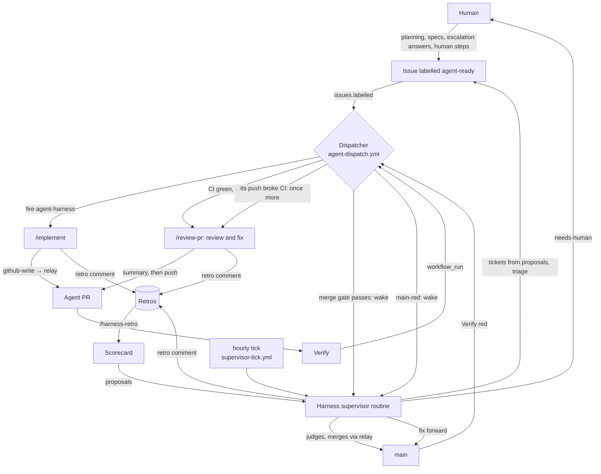

# Runners

How agent runs execute, and how the parts of the agent workflow ("the harness") fit together. Each section names
the files that own its behaviour; where this page and an owner disagree, the owner wins. Why the harness is this
shape is in the ADRs (`docs/adr/`); ADR 0004 records the latest simplification.

## The big picture

Work is GitHub issues, and labels are the state. A GitHub Actions workflow, the **dispatcher**, reacts to label,
PR and CI events and starts the next step: an agent run in a Claude cloud session (a **routine**). Agents don't
write to GitHub as themselves from a cloud session: they ask a second workflow, the **relay**, to make each write
as the bot. Once a PR's review run has finished and its head passes the **merge gate**, the dispatcher wakes the
**harness supervisor**, which judges the PR and merges it (ADR 0003). If a merge turns `main` red, the dispatcher
wakes the supervisor to fix it forward; only a human turns on the **kill switch**. The supervisor also does the
human's routine part of the workflow and escalates what needs the human. Every run writes a **retro**, a weekly
**harness retro** turns retros into proposals, and the supervisor turns proposals into tickets.

A ticket's life:

1. **It becomes a ticket.** A human plans (`/today` → grill-with-docs → to-spec → to-tickets), or the supervisor
   turns a scorecard proposal into one. The issue gets an Agent Brief (`.agents/skills/triage/AGENT-BRIEF.md`),
   any blocking links, `harness` as a tag if it's harness work, and `agent-ready` last.
2. **The dispatcher starts `/implement`** once nothing blocks the issue ("Routing").
3. **`/implement` builds it** test-first, reviews and verifies it, opens the PR through `github-write`, waits for
   CI and posts a retro (`.agents/skills/implement/SKILL.md`).
4. **`/review-pr` reviews and fixes it** once CI is green, posts one summary of what it changed and left, and
   pushes; a second run starts only if its push broke CI ("Review budget" in `docs/agents/review.md`).
5. **The harness supervisor merges it** ("Merge gate"). Merging closes the issue, which can start the next ticket
   in a chain. If the PR has `## Human steps`, the supervisor hands them to the human.
6. **`main` is verified.** A red `main` wakes the supervisor to fix it forward ("Main is red").

### Who does what

| Actor                        | What it is                                                                          | Decides                                                                             |
| ---------------------------- | ----------------------------------------------------------------------------------- | ----------------------------------------------------------------------------------- |
| **Human**                    | You                                                                                 | Product direction, specs, answers to escalations, settings and secrets              |
| **Dispatcher**               | `agent-dispatch.yml` + `.harness/src/cli/dispatch.ts` (pure logic in `dispatch.ts`) | Nothing by judgement: fixed rules turn events into runs and wakes                   |
| **`agent-harness` routine**  | The cloud routine for `/implement`, `/review-pr` and the weekly `/harness-retro`    | How to build, or review and fix, one item                                           |
| **Relay**                    | `agent-relay.yml` + `cli/relay-apply.ts` (logic in `relay.ts`)                      | Nothing: makes each write as the bot, refusing only settings, variables and secrets |
| **Harness supervisor**       | The `harness-supervisor` routine running `/supervise`                               | Merges, red `main`, stalled runs, triage, tickets, escalations                      |
| **CI**                       | `verify.yml` (`moon ci`)                                                            | Whether code is green                                                               |
| **Auto mode's safety check** | Anthropic's classifier on cloud-session actions, outside the repo                   | Refuses actions it judges unsafe; agents stop rather than work around it            |

### Inventory

| Part                                                                            | Purpose                                                                         |
| ------------------------------------------------------------------------------- | ------------------------------------------------------------------------------- |
| `.github/workflows/agent-dispatch.yml`                                          | The dispatcher                                                                  |
| `.github/workflows/agent-relay.yml`                                             | The relay                                                                       |
| `.github/workflows/supervisor-tick.yml`                                         | The tick: reads the kill switch and fires the supervisor's hourly run           |
| `.github/workflows/verify.yml`                                                  | `moon ci`; red on `main` wakes the supervisor                                   |
| Skills `implement`, `review-pr`, `supervise`, `retro`, `harness-retro`          | The workflow's runs (`.agents/skills/`); `today` is the human's entry point     |
| `dispatch.ts`, `cli/dispatch.ts`, `cli/github-facts.ts`                         | The dispatcher's decisions, and the GitHub facts it decides from                |
| `supervisor-tick.ts`, `cli/supervisor-tick.ts`                                  | The tick                                                                        |
| `relay.ts`, `cli/relay-apply.ts`, `github-write.ts`, `cli/github-write.ts`      | The relay, and agents' write path to it                                         |
| `agent-status.ts`, `cli/agent-status.ts`                                        | The `Agent review` check and the `Agent status` comment ("Status on GitHub")    |
| `cli/merge-gate.ts`                                                             | The supervisor's merge gate check before it merges                              |
| `review-threads.ts`, `cli/review-threads.ts`                                    | Which review threads wait for an answer                                         |
| `ci-status.ts`, `cli/wait-for-ci.ts`, `branches.ts`                             | Whether a head is green, waiting for CI, and agent branch names                 |
| `hooks/*`, `run-state.ts`, `session-env.ts`, `agent-env.ts`, `interjections.ts` | Session setup, run state and the interjection log ("Guardrails")                |
| `github-app-token.ts`, `cli/gh-token.ts`                                        | Bot installation tokens                                                         |
| `harness.config.json`, `config.ts`, `cli/config.ts`, `cli/verify.ts`            | The project's config, its reader, and the verify command ("Project config")     |
| `.harness/setup-wizard.sh`, `.harness/cloud-setup.sh`                           | Human setup steps; the cloud environments' setup script                         |
| `.harness/manifest.json`, `manifest.ts`, `.harness/.node-version`               | Every path the harness owns, and the Node it runs on (`docs/agents/harness.md`) |

GitHub-side state: the **Harness scorecard** (while `retros` is on) and the **Supervisor log**, issues found
by their titles.

## Project config

Every value that differs between projects using the harness is in `harness.config.json` at the repo root.
The project owns that file, not the harness: it sits outside the harness folder, so a harness upgrade never
overwrites it. `.harness/src/config.ts` reads and checks it, and documents each key; skills read a value
with `node .harness/src/cli/config.ts <key>`.

| Key                                              | What it names                                                                               |
| ------------------------------------------------ | ------------------------------------------------------------------------------------------- |
| `bot`                                            | The agent GitHub App's slug; its login, the author of agent comments, is `<bot>[bot]`       |
| `routines.coding`, `routines.supervisor`         | The cloud routines (`docs/agents/cloud-routines.md`): `agent-harness`, `harness-supervisor` |
| `environments.coding`, `environments.supervisor` | The cloud environments they run in                                                          |
| `verify`                                         | The command that checks the whole project; run it with `node .harness/src/cli/verify.ts`    |
| `retros`                                         | Whether runs post retros (`/retro`); off when left out                                      |

Values GitHub already provides aren't configured: the repository comes from `{owner}/{repo}` in `gh api` paths,
`GITHUB_REPOSITORY` or the git remote, and the default branch from the repository's `default_branch`. The
docs call the default branch `main`. The CI workflow must be named `Verify`: the dispatcher's
`workflow_run` trigger names it, and a workflow trigger can't read a file.

**`retros` off.** `/retro` records no events and posts only a run report (`<!-- agent-run v1 -->`) with the
run's data, since the relay finishes the run's status from it (`parseRetro` in `agent-status.ts`).
`/harness-retro` stops at once, so there's no scorecard, and `/supervise` and `/today` skip their scorecard
steps. Turn it on once the project's proposals have a way to reach the harness.

### Where a human still comes in

- **Product work:** planning interview → spec → tickets (`/today`).
- **Escalations:** answer `needs-human` items (`docs/agents/labels.md`).
- **Human steps:** apply a merged PR's `## Human steps` when the supervisor hands them on.
- **Safety-check refusals:** approve the step in the session, or add an allow rule.
- **Platform settings:** routines, environments, secrets and App permissions (`docs/agents/cloud-routines.md`),
  and branch protection once the plan offers it ("Guardrails").
- **The kill switch** ("Kill switch").

## Where runs execute

The same skills run in two places. Skills never depend on which one they're in: they take an issue or PR
number, read the current state from GitHub, and resume from there.

| Runner  | Where                                 | Can a human interject?        | Started by                |
| ------- | ------------------------------------- | ----------------------------- | ------------------------- |
| `cloud` | Claude Code cloud session (a routine) | Yes, in the Claude app or web | The dispatcher workflow   |
| local   | Your terminal                         | Yes                           | You, e.g. `/implement 42` |

The dispatcher is `.github/workflows/agent-dispatch.yml` (logic in `.harness/src/dispatch.ts`). It fires the
routines described in `docs/agents/cloud-routines.md`.

### Routing

Every coding run (`/implement` and `/review-pr`) fires the `agent-harness` routine (Opus), whatever
the item's labels, with the payload `{"skill": ..., "number": ...}`. Runs are unattended: the routine prompt
runs the skill straight through, though you can watch, and type into, any run in the Claude app. The harness
supervisor has its own routine (see "Merge gate").

## Events the dispatcher skips

The dispatcher's `Route` job has an `if:` that skips events before a runner starts, since skipped jobs aren't
billed. It skips only events `dispatch.ts` would end with no run, merge or wake:

- `issues.labeled` and `pull_request_target.labeled` for any label but `agent-ready` (issues), `needs-review`
  (PRs), and `agent-blocked` (both)
- `pull_request_target.opened` from a branch that isn't an agent branch
- `workflow_run` and `check_run` with no PR in the payload, or a PR that isn't on an agent branch.
  Verify pushed to `main` always runs, and so does a `check_run` concluding `stale` (a failed agent run wakes
  the harness supervisor on any branch)
- `issue_comment`, `pull_request_review_comment` and `pull_request_review` from a bot (a `[bot]` login) or
  someone who isn't a collaborator, or with any action but `created` (comments) or `submitted` (reviews)

The comment above `Route`'s `if:` names the
function each clause mirrors, and `.harness/src/dispatch-workflow.test.ts` checks the labels, conclusions,
comment authors and branch prefixes against the code. When `dispatch.ts` starts acting on a new label or branch, widen the
filter in the same PR, or the test fails. `Route` installs only the harness's Node (`.harness/.node-version`), not the project's toolchain: the
dispatcher needs only Node's standard library.

## Kill switch

The `AGENTS_PAUSED` repository variable stops every new agent run. While it's `true` (in any case), the
dispatcher still runs for every event but starts nothing: no cloud routine fires.
Its step summary says it's paused and names each run it skipped. A review run it skipped isn't replayed: the
harness supervisor's hourly run finds the PR afterwards. Any other value dispatches as normal, and a value other than
`false` (say `1` or `yes`) adds a warning to the step summary that it didn't pause. Runs already going carry
on; a harness supervisor run that started before the pause can still merge, since the relay doesn't check the
switch. Closing abandoned agent PRs still works while paused.

**The kill switch is human-only.** Nothing in the harness turns it on: a red `main` wakes the harness supervisor,
which fixes it forward (see "Main is red"), and escalates to the human if that doesn't work. A human
pauses when they want everything to stop.

The dispatcher reads the variable, through `isPaused()` in `.harness/src/dispatch.ts`. Every run the
dispatcher starts goes through `holdIfPaused()`, and the harness supervisor isn't woken while it's on, so it
makes no merges then; when it runs anyway (its hourly trigger), it stops at once while paused (`/supervise`).
The relay refuses every write to the variable, so no agent can turn it off. The harness supervisor's cloud
session can't read Actions variables (the proxy answers 403), so every payload the dispatcher sends it carries
`paused`, and it counts any payload without `"paused": false` as paused.

To flip it, open the repo's **Settings → Secrets and variables → Actions → Variables** tab
(`https://github.com/<owner>/<repo>/settings/variables/actions`), on the web or in a phone's browser if
the GitHub app doesn't show repository settings:

- **Pause:** create `AGENTS_PAUSED` with the value `true`.
- **Resume:** edit it to `false`, or delete it.

From a terminal, the `gh` CLI's `variable set` and `variable delete` commands do the same. Agents and the
dispatcher never flip it.

The agent App may still hold the Variables permission from when the dispatcher could pause. Agent runs never
write Actions variables or secrets (see "Guardrails"), though they can read them.

Pausing doesn't replay what it skipped. To start one of those runs after resuming, re-apply its trigger label.
Re-applying one while paused starts no run.

## Environment variables

Every agent run gets these. Skills and hooks read them, so behaviour doesn't depend on the runner.

| Variable        | Value                  | Meaning                                                                         |
| --------------- | ---------------------- | ------------------------------------------------------------------------------- |
| `AGENT_RUN`     | `1`                    | This is an agent run, not a human's own session                                 |
| `AGENT_RUNNER`  | `cloud`                | Where the run executes                                                          |
| `AGENT_SKILL`   | e.g. `implement`       | The skill being run                                                             |
| `AGENT_HARNESS` | `1` or unset           | Harness files may change: set in both cloud environments, so in every cloud run |
| `GH_TOKEN`      | bot installation token | The GitHub identity to use (see `docs/agents/issue-tracker.md`)                 |

When `AGENT_RUN` is unset, you are in a human's interactive session.

A cloud environment's variables are the same for every run, so cloud runs only get `AGENT_RUN`,
`AGENT_RUNNER` and `AGENT_HARNESS`. Every coding run runs in the
coding environment (`environments.coding` in `harness.config.json`). The skill comes from
the dispatcher's payload, which the routine prompt passes on.

In cloud runs the proxy applies your account to API calls, so agents make their GitHub writes through `github-write`, which relays
each one to the bot via the `agent-relay` workflow (see `docs/agents/cloud-routines.md`).
The hooks read these:

| Variable                                   | Meaning                                                  |
| ------------------------------------------ | -------------------------------------------------------- |
| `GITHUB_AGENT_APP_ID`                      | The agent GitHub App's ID                                |
| `GITHUB_AGENT_APP_PRIVATE_KEY` or `…_PATH` | Its private key, inline (`\n` escapes allowed) or a file |
| `GITHUB_AGENT_GIT_NAME` / `…_EMAIL`        | Optional: the commit author, `<bot>[bot]`                |

## Guardrails

The guardrails are the skills' own rules, which every agent run follows:

- Push only your own agent branch (`<type>/<issue>-<slug>`): never `main`, never a force-push, and never
  delete a branch. The harness supervisor's exception: it pushes to another run's agent branch to make a small fix
  or merge `main` in (`/supervise`, **Fix it yourself**).
- Make every GitHub change through `github-write` ("Writing" in `docs/agents/issue-tracker.md`), never with
  `gh api`, other `gh` subcommands or the `mcp__github__*` write tools directly. Never edit the repository, its
  labels, or its Actions variables and secrets (`AGENTS_PAUSED` is the human's kill switch; the relay refuses
  these writes, its one hard rule), and never merge or close a PR: only the harness supervisor does, through
  `github-write` (`/supervise`).
- Run the verify command (`node .harness/src/cli/verify.ts`) before finishing, push the work, and post a
  retro (only a run report while `retros` is off, see "Project config").

Nothing in the session enforces these: retros surface a run that breaks one, and the harness supervisor
tickets a fix. GitHub-side enforcement would come from branch protection, but branch protection needs GitHub
Team (or Pro) for a private repo, and this organisation is on the free plan. Until that changes, **nothing on
GitHub stops a push to `main`**: the skills and the merge gate are the only guardrails.

`.claude/settings.json` registers two hook events, SessionStart and UserPromptSubmit, whose hooks are in
`.harness`. In a cloud session, SessionStart first runs `cloud-install.ts`, whatever `AGENT_RUN` is: it
puts the pinned toolchain on `PATH` and runs `npm ci` if the project has a `package-lock.json`. The hooks below act only when `AGENT_RUN=1`:

| Hook               | In agent runs                                                                                                                                                                |
| ------------------ | ---------------------------------------------------------------------------------------------------------------------------------------------------------------------------- |
| `SessionStart`     | Makes `GH_TOKEN` a bot token that refreshes itself. If a token can't be minted, `GH_TOKEN` is set to a value GitHub rejects, so `gh` fails instead of acting as someone else |
| `UserPromptSubmit` | Logs each human message for `/retro`                                                                                                                                         |

## Run state

Hooks and skills share state through `.agent-run/` (gitignored) at the repo root:

| File                  | Written by                | Read by                                   |
| --------------------- | ------------------------- | ----------------------------------------- |
| `interjections.jsonl` | the UserPromptSubmit hook | `/retro`                                  |
| `gh-token.json`       | the token helper          | the token helper (never read it yourself) |

## Merge gate

The harness supervisor decides and makes every agent PR's merge (ADR 0003, which reverses ADR 0002's "plain code
merges, not an agent"): the dispatcher merges nothing. Whenever a check
on a gated PR's head finishes (Verify through `workflow_run`, any app's check, `Agent review`
included, through `check_run`), the dispatcher runs `onMergeCheck()` in `.harness/src/dispatch.ts`: an agent
PR whose merge is the harness supervisor's to decide (`isMergeCandidate()`) wakes it with a `mergeable`
reason: it's open, on an agent branch, and passes `mergeGate()`, and `AGENTS_PAUSED` is off. The gate's review condition is that the PR's review run has finished ("Review budget" in
`docs/agents/review.md`). A finished review run whose head is red with its budget spent wakes it with
`red-after-review` instead.

The harness supervisor then judges the PR (`/supervise`, **Merge**), checks the gate on facts read just then
(`cli/merge-gate.ts`, which reads them with `githubFacts().pullFacts`, the dispatcher's own, and also
refuses a closed PR or one not on an agent branch: `supervisorMerge()`), and
merges it with `github-write`. The relay doesn't check the gate again: it makes the merge as it was sent. So
the gate is the minimum: the harness supervisor may refuse more, never less. `mergeGate()` checks exactly the
glossary's **Merge gate** conditions:

- every check on the head is green;
- the PR's review run has finished;
- there's no merge conflict: GitHub works out whether a PR can merge in the background after a push, and
  `pullFacts` waits up to 30 seconds for it, then refuses, so the PR merges on the next event for its head;
- nothing flags it for a human: no `needs-human` or `agent-blocked` on the PR or its issue.

The dispatcher's step summary, or `merge-gate.ts`'s `note`, names the first condition a PR failed. Open review threads
and requested changes aren't gate conditions: the harness supervisor weighs them when it judges the PR.

Nothing wakes the harness supervisor by itself when a human removes a hold label; its next hourly run finds the
PR (see "The tick"). To
wake it straight away without starting a new review, re-run the head commit's `Verify` run (**Re-run all jobs**
from the PR's **Checks** tab, or the Actions tab).

A merge is a squash as the bot, pinned to the head commit that was checked, so GitHub refuses the merge
if anything was pushed in the meantime. The commit title is the PR title plus ` (#<pr>)`, and the description
is the `text` block under the PR body's `## Commit message`; without one, the `## Summary` section; and with
neither, none, so the body's Markdown never reaches `main`'s history. Harness PRs go through the same gate.

The merge uses the agent App's token (the `AGENT_APP_ID` variable and `AGENT_APP_PRIVATE_KEY` secret), through
the relay, so the push to `main` and the issue closing start their own workflows. The App needs Contents: read
and write to merge, and Workflows: read and write to merge a PR that changes `.github/workflows/`.

The facts the gate decides from (`cli/github-facts.ts`) are read with the workflow's own token, so the
workflow's `permissions:` must cover every API they read, `actions: read` included: `breakingMerge()` reads
`main`'s Verify runs, and those reads got HTTP 403 without it (#112). `dispatch-workflow.test.ts`
checks each path `github-facts.ts` reads against those permissions.

Agents are trusted (#161), so the relay makes any agent run's merge; the skills tell every run but the harness
supervisor never to merge. The harness supervisor's own session runs its `github-write.ts PUT …/merge` command
under the allow rule in `.claude/settings.json`; it never merges any other way. The `Agent …` checks are made by the agent App, so their `check_run` events reach
workflows. GitHub doesn't run workflows for `check_run` events on check suites Actions created
([docs](https://docs.github.com/en/actions/reference/workflows-and-actions/events-that-trigger-workflows#check_run)),
and the dispatcher's `route` job skips `check_run` events from `github-actions` too, so it can't trigger
itself. `check_run` and `workflow_run` events list only PRs from this repository, which agent PRs always are.

## Main is red

Verify runs on every push to `main`, and runs there are never cancelled. When one finishes, the dispatcher
(`onMainVerified()` in `.harness/src/dispatch.ts`) looks at the PR merged as that commit. A run counts as on
`main` only if its commit is on `main`: the dispatcher ignores any other run, and so does `breakingMerge()`. The
dispatcher never merges or pauses by itself (#63, the human's decision of
2026-10-23: "if something breaks, let's not pause everything — allow the supervisor to fix forward"):

| Verify on `main` | The dispatcher                                                                                                            |
| ---------------- | ------------------------------------------------------------------------------------------------------------------------- |
| fails            | wakes the harness supervisor with `main-red`: the failing run, the PR and how it merged, and the commit that broke `main` |
| passes           | nothing                                                                                                                   |

Verify fails on any conclusion `isRed()` counts as red, which is everything but passing, cancelled or skipped,
so a timed-out run fails too. The `main-red` reason's `by` is `merge-gate`, `human`, or `null` for a push without
a PR, and `breaking` is `breakingMerge()`, the oldest red commit since the last green one, with the PR merged as
it: the merge to fix when later merges are red too.

The harness supervisor then gets `main` green (`/supervise`, **Main is red**), and records each attempt with a
`main-red` comment on the breaking merge's PR. `main`'s latest finished Verify run decides whether it's red, not the
reason: by the time a `main-red` wake is handled, a later commit may have fixed `main`.

- **Fix forward, always:** it fixes `main` itself when the fix is small and clear, or opens a `fix/` ticket with
  the failing run's error and the breaking merge, `main-red` in its brief, labelled `agent-ready` (and
  `harness` for harness code), so `/implement` starts at once. Its PR is the next thing it merges. A revert is
  just an ordinary PR, reviewed like any other, when that's the quickest fix. A human's red merge is fixed the
  same way, tagging the human on the fix PR.
- **Merge freeze:** while `main` is red, it merges only the fix. Other PRs wait with one `held`
  comment each, naming their head so it isn't repeated, and their runs carry on. Once `main` is green, it
  decides the PRs it held.
- **Escalation:** once the second attempt has landed with `main` still red, or 2 hours after the first attempt, it
  escalates to the human with `needs-human` and a push
  notification. It still doesn't pause: only a human turns the kill switch on. Nothing wakes it when the 2 hours
  pass: it checks on every wake, and the tick wakes it hourly, so the escalation can come up to an hour late.

## Waking the harness supervisor

The harness supervisor (`/supervise`) runs in its own routine (see `docs/agents/cloud-routines.md`). It reads the
open issues and PRs itself with `gh api` and decides what needs doing. Two things fire it: the dispatcher, straight
away on urgent events, and the tick, once an hour. Nothing fires it more often than that.

### Urgent events

The dispatcher fires it on these events (`urgentReasons()` and `wakeSupervisor()` in `.harness/src/dispatch.ts`):

- `agent-blocked` is added to an issue or PR
- an agent run fails: an `Agent review` check from the agent App ends `stale` (GitHub's,
  after 14 days). A crashed cloud run can't settle its check, so an hourly run finds it first
- Verify fails on `main` (`main-red`, from `onMainVerified()`; see "Main is red")
- an agent PR becomes a merge candidate (`mergeable`, see "Merge gate"), so the harness supervisor decides its merge,
  or is red once its review budget is spent (`red-after-review`)
- a routine fire fails: the dispatcher's `Cloud · <skill> #<n>` job retries a busy routine API (a 429 or 5xx) with
  backoff, honouring `Retry-After` (`fireRoutine()` in `.harness/src/routine-fire.ts`), and if it still fails,
  wakes the harness supervisor with a `fire-failed` reason naming the skill and item, so it restarts the run
- a person comments on, or reviews, any issue or PR, whatever its labels (`comment`): an issue or PR comment, a
  review or a review comment by a collaborator (`isHuman()` in `.harness/src/dispatch.ts`).
  Bots' comments, the agent bot's included, never wake it, so its own replies can't loop. GitHub doesn't run the
  review events on a PR with a merge conflict, so a review there waits for the hourly run

The payload is `{"skill": "supervise", "paused": false, "reasons": [...]}`, naming each event, so it starts on
those items. `paused` is there because the harness supervisor can't read the kill switch itself (see "Kill
switch"). Nothing
fires while the kill switch is on, or until the `ROUTINE_HARNESS_SUPERVISOR_URL` and `_TOKEN` secrets are set;
the step summary says which. A run that ends blocked isn't counted as failed: its `agent-blocked` label wakes the
harness supervisor already.

### The tick

The routine's hourly trigger is the cadence. That run has no payload, and the cloud proxy refuses Actions variables,
so it can't read the kill switch: `/supervise` fires `.github/workflows/supervisor-tick.yml` with
`workflow_dispatch`, and ends there, with no retro. The tick reads
`AGENTS_PAUSED` in Actions and fires the routine with `{"skill": "supervise", "paused": false, "reasons": []}`
(`tick()` in `.harness/src/supervisor-tick.ts`). It fires nothing when:

- the kill switch is on.
- the routine's secrets aren't set.

Its step summary says which. The tick has no `schedule:` of its own, and the dispatcher doesn't fire it.

**A paused wake does nothing.** The dispatcher and the tick fire nothing while the kill switch is on. A run whose
payload doesn't say `"paused": false` stops at **Start**, posting nothing, not even a retro.
A human's own run with no payload reads `AGENTS_PAUSED` itself.

Every run that isn't paused works every duty and posts its retro on the Supervisor log. A dispatcher wake can
overlap the hourly run: each run checks, right before it writes on an item, that no other run has commented on it
since it read it.

`mergeable` can be reported again for a head the harness supervisor has already decided: its comments update the
PR, and an hourly run sees a green agent PR again. So it decides each head once (its comments name the head they judged): once it has escalated a
head, a later wake for that head is left alone, and while `main` is red, a head it has `held` gets no second
note. `mergeGate()` refuses a head with a review run going on it: the dispatcher wakes it when that check finishes.

Every run reads GitHub's `mergeable` for each open agent PR (**Conflicts** in `/supervise`). It merges `main` into a
conflicted one itself when that's mechanical, and escalates it otherwise, unless it waits on the human or its
`escalate` comment already names its head. GitHub works `mergeable` out in the background and can answer `null` for
a while after `main` moves; the next run looks again.

Every run also watches the whole workflow for faults, beyond its own items: failed workflow runs and their
logs, items that should be moving but aren't, `main`, and setup drift. Each fault gets fixed, ticketed as
`agent-ready` `harness` work, or escalated, and its retro lists them.

**Cost:** about 24 hourly runs a day, plus one per urgent event.

## Status on GitHub

Every run shows where it's up to on GitHub (`.harness/src/agent-status.ts`):

- **PRs:** a check on the head commit, next to `Verify`: `Agent review` (reviews, fixes and pushes). It appears, in
  progress, when the dispatcher starts the run, and its **Details** link opens the session. It finishes when the run
  does, and when the run pushed, the result is copied onto the new head; a run that ends blocked shows **Action
  required**. The dispatcher reads it to know the run has finished ("Review budget" in `docs/agents/review.md`).
- **Issues:** one `Agent status` comment, updated in place: picked up (with the session link), then the
  outcome, such as the PR it opened. A log of each update sits underneath.

Agents don't do anything for this. The dispatcher starts the status, and the relay finishes it when the
run's retro is posted, so a cloud run that ends without a retro leaves its check running:
open the session to see why.

## Taking over a run

To steer a run that's going wrong, type into its session in the Claude app. To start over, run the skill
locally (e.g. `/implement 42`) or re-apply the trigger label (`agent-ready` or `needs-review`). The new run
finds the existing branch and PR and carries on from there.

## Budgets

Agent runs are bounded so a stuck run can't run up usage:

- **Cloud:** no hard limit. Runs rely on the skills' own stops below.
- **Every runner:** skills stop with `agent-blocked` after three red CI runs in a row.
- **The review budget:** one `/review-pr` run per PR, and a second only if the first's push broke CI ("Review
  budget" in `docs/agents/review.md`). After that, the harness supervisor decides.
